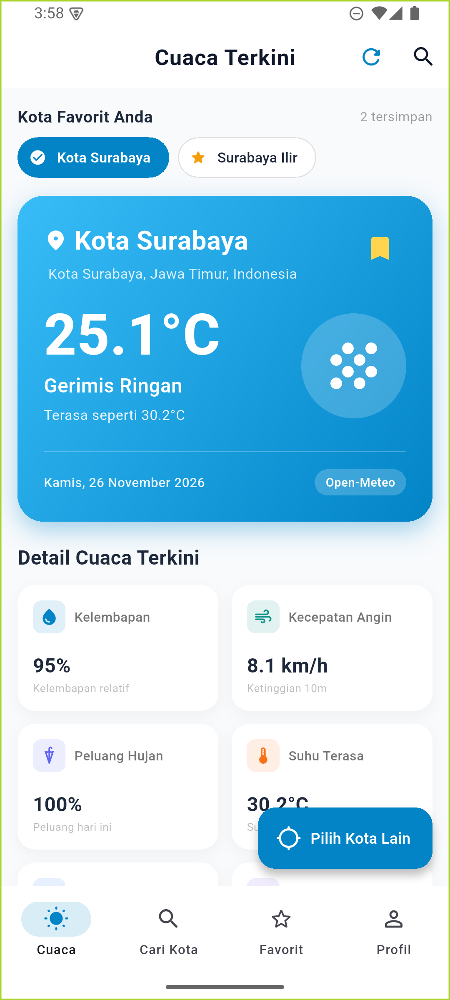
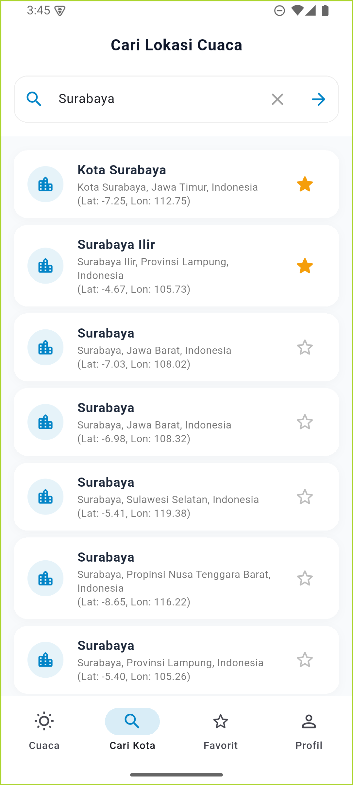
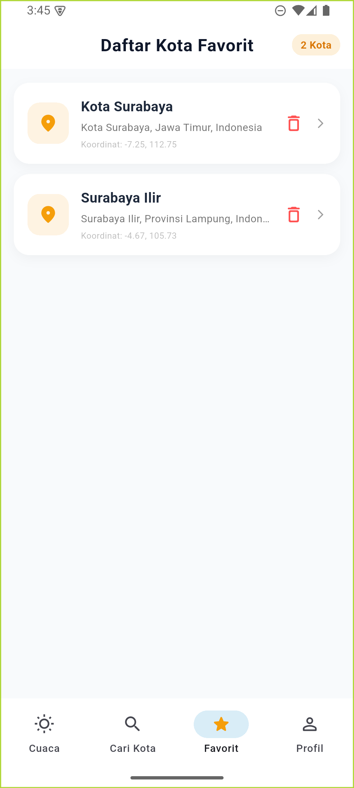
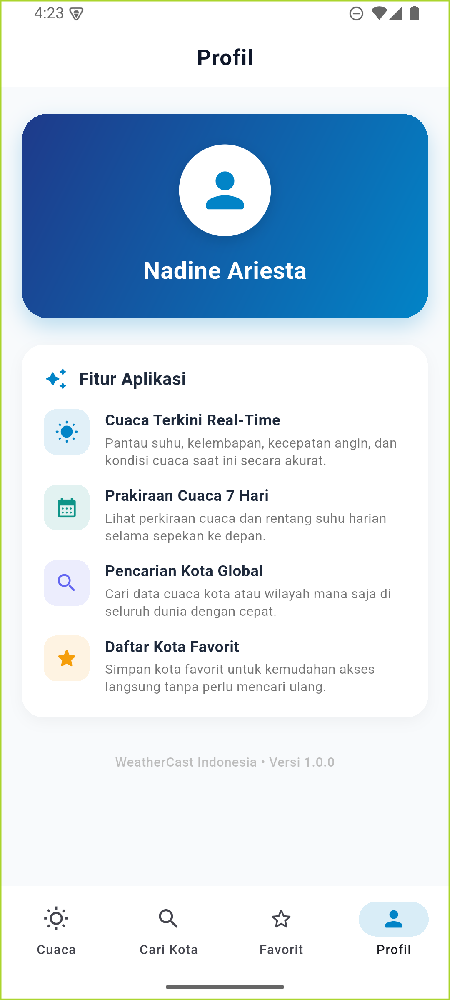

# Responsi Flutter - Aplikasi Cuaca Open-Meteo (WeatherCast)

**Nama:** Nadine Ariesta  
**NIM:** H1D024028  

---

Aplikasi mobile berbasis **Flutter** dan **Dart** untuk memantau prakiraan cuaca real-time dan ramalan 7 hari ke depan dengan memanfaatkan **Open-Meteo REST API**, arsitektur **Model-View-ViewModel (MVVM)**, state management **Provider**, serta penyimpanan lokal **SharedPreferences**.

---

## 📱 Deskripsi Aplikasi

Aplikasi WeatherCast menyajikan informasi meteorologi cuaca terkini secara akurat dan komprehensif tanpa menggunakan data statis/hardcoded. Pengguna dapat melihat suhu saat ini, kondisi cuaca, suhu yang dirasakan, kelembapan, kecepatan angin, curah hujan, serta ramalan cuaca 7 hari ke depan. Aplikasi juga menyediakan pencarian lokasi kota secara global berbasis koordinat presisi, penyimpanan lokasi favorit secara offline, serta riwayat pencarian.

---

## 🖼️ Screenshot Tampilan Aplikasi

Berikut adalah dokumentasi tangkapan layar antarmuka aplikasi pada setiap layarnya:

| 1. Home / Weather Screen | 2. Search / Location Screen | 3. Favorites Screen | 4. Profile Screen |
|:---:|:---:|:---:|:---:|
|  |  |  |  |
| *Cuaca real-time, detail 6 parameter, ramalan 7 hari & quick chips* | *Pencarian kota live via Geocoding API & bookmark favorit* | *Daftar kota favorit tersimpan offline & tombol kelola* | *Profil pengembang & ringkasan fitur aplikasi* |

---

## 1. Teknis

### a. Bahasa
- **i. Flutter & Dart**: Aplikasi dikembangkan murni menggunakan framework **Flutter** dan bahasa pemrograman **Dart** versi terbaru.
- **ii. StatefulWidget dan StatelessWidget**:
  - `StatefulWidget`: Digunakan pada layar yang memiliki state dinamis dan interaksi pengguna, seperti `HomeScreen`, `SearchScreen`, `FavoritesScreen`, dan `MainNavigationWrapper`.
  - `StatelessWidget`: Digunakan pada komponen antarmuka yang bersifat murni presentasional, seperti `WeatherInfoCard`, `WeatherDetailGrid`, `ForecastItemCard`, dan `AboutScreen`.

### b. UI (User Interface)
- **i. Flutter Widgets**: Antarmuka dibangun secara modular memanfaatkan widget bawaan Flutter (`Scaffold`, `NavigationBar`, `ListView`, `SingleChildScrollView`, `Card`, `Container`, `Row`, `Column`, `InkWell`, dsb).
- **ii. Material Design**: Menggunakan standar desain **Material Design 3** (`useMaterial3: true`) untuk tampilan modern dan bersih.
- **iii. Theme Konsisten**: Mengimplementasikan `ThemeData` terpusat pada `lib/utils/app_theme.dart` yang mengatur palet warna (primer sky-blue `#0284C7`, latar `#F8FAFC`), tipografi, dan bentuk kartu secara konsisten di seluruh layar.
- **iv. Typography**: Menggunakan hierarki tipografi Material 3 yang jelas, kontras, dan nyaman dibaca pada berbagai ukuran layar perangkat.
- **v. Responsif & Mudah Digunakan**: Tata letak fleksibel menggunakan layout scrollable, grid 2-kolom adaptif, pull-to-refresh untuk memuat ulang cuaca, serta navigasi bottom navigation bar yang mudah diakses dengan satu tangan.

### c. List & Data
- **i. Local Storage**: Mengimplementasikan penyimpanan lokal untuk menyimpan data kota favorit (`favorite_locations`) dan riwayat pencarian lokasi pengguna (`search_history`).
- **ii. Retensi Data**: Seluruh data yang tersimpan di local storage otomatis dimuat dan ditampilkan kembali ketika aplikasi pertama kali dibuka maupun saat berpindah tab.
- **iii. Library Penyimpanan**: Menggunakan library resmi **`shared_preferences`** (`shared_preferences: ^2.5.4`) dengan serialisasi dan deserialisasi data ke format JSON String.

### d. State & Recomposition
- **i. Pengelolaan State Berbasis API**: Tampilan antarmuka otomatis diperbarui secara reaktif setiap kali data cuaca atau hasil pencarian baru diterima dari REST API.
- **ii. Fitur Pencarian Berdasarkan Nama Kota**: Menyediakan kolom input pencarian teks kota yang secara real-time mengirim permintaan pencarian ke endpoint Open-Meteo Geocoding.
- **iii. Pemilihan Lokasi**: Hasil pencarian dapat diklik untuk langsung mengubah kota aktif dan menampilkan informasi cuaca lengkap kota tersebut pada layar utama.
- **iv. State Management Provider**: Menggunakan **`Provider`** (`ChangeNotifierProvider`) dengan pola `ChangeNotifier` (`WeatherViewModel` dan `SearchViewModel`) untuk memisahkan logika data dari antarmuka serta meminimalkan rebuild yang tidak perlu.

### e. Networking
- **i. REST API Open-Meteo**: Mengambil informasi prakiraan cuaca dan pencarian lokasi langsung dari layanan REST API publik Open-Meteo tanpa API key.
- **ii. HTTP Request Metode GET**: Implementasi pemanggilan jaringan menggunakan method `GET` melalui package `http`.
- **iii. Pengolahan Respons JSON**: Respons berformat JSON dari server diolah dan diparsing secara type-safe ke dalam model data Dart (`WeatherForecastModel`, `CurrentWeather`, `DailyForecastItem`, `LocationModel`).
- **iv. Data Sesuai Lokasi Terpilih**: Query parameter `latitude` dan `longitude` dikirimkan secara dinamis sesuai koordinat kota yang sedang dipilih pengguna.
- **v. Penanganan Kondisi (Loading, Kosong, Error)**:
  - **Loading**: Menampilkan indikator putar (`CircularProgressIndicator`) saat proses pengambilan data berlangsung.
  - **Data Kosong**: Menampilkan ilustrasi dan pesan informatif saat riwayat/favorit atau hasil pencarian tidak ditemukan.
  - **Error**: Menangani kegagalan koneksi atau offline dengan pesan error yang jelas serta tombol **"Coba Lagi"** untuk memicu pengambilan ulang data.

### f. Architecture
- **i. Pola Arsitektur Model-View-ViewModel (MVVM)**: Proyek diorganisasi secara ketat memisahkan tanggung jawab:
  - **Model (`lib/models/`)**: Merepresentasikan struktur data entitas bisnis (`LocationModel`, `WeatherForecastModel`, `WeatherCodeHelper`).
  - **View (`lib/views/`)**: Menangani antarmuka pengguna, input, dan menampilkan state dari ViewModel (`HomeScreen`, `SearchScreen`, `FavoritesScreen`, `AboutScreen`, `widgets/`).
  - **ViewModel (`lib/viewmodels/`)**: Menjembatani View dan Model/Services, memegang state aplikasi, dan memanggil fungsi logika (`WeatherViewModel`, `SearchViewModel`).
  - **Services (`lib/services/`)**: Menangani operasi I/O eksternal (`ApiService` untuk REST API dan `LocalStorageService` untuk SharedPreferences).

### g. Screens

Aplikasi memiliki antarmuka yang terbagi ke dalam layar-layar fungsional berikut:

#### 1. Home / Weather Screen (`lib/views/home_screen.dart`)
- **a. Nama Kota Terpilih**: Menampilkan nama kota dan wilayah administratif lengkap yang sedang dipantau.
- **b. Kondisi Cuaca Terkini**: Menampilkan teks kondisi cuaca dalam bahasa Indonesia (misal: "Cerah", "Gerimis Ringan", "Hujan Lebat") beserta ikon ilustrasi dan gradien warna kartu dinamis.
- **c. Suhu Saat Ini**: Menampilkan nilai suhu aktual dalam satuan derajat Celcius (°C) berukuran besar.
- **d. Informasi Tambahan**: Menampilkan kelembapan udara (%), kecepatan angin (km/h), kemungkinan peluang hujan (%), suhu yang dirasakan (°C), curah hujan (mm), dan kode standar WMO dalam grid 6 parameter.
- **e. Perkiraan Cuaca Harian**: Menampilkan daftar ramalan cuaca 7 hari ke depan lengkap dengan hari/tanggal, ikon kondisi cuaca, dan rentang suhu minimum hingga maksimum.
- **Fitur Tambahan Layar**: Baris quick-chip untuk berpindah antar kota favorit tersimpan secara instan dan dukungan pull-to-refresh.

#### 2. Search / Location Screen (`lib/views/search_screen.dart`)
- **a. Input Pencarian Kota**: Kolom teks input dengan auto-focus, tombol submit pencarian, dan tombol hapus input cepat.
- **b. Daftar Hasil Pencarian Lokasi**: Menampilkan daftar kota hasil query dengan informasi nama kota, provinsi/negara, dan koordinat lintang serta bujur.
- **c. Memilih Lokasi**: Mengetuk item hasil pencarian otomatis menetapkan kota tersebut sebagai lokasi cuaca aktif dan beralih ke layar cuaca utama.
- **d. Menyimpan Lokasi Sebagai Favorit**: Dilengkapi ikon bintang pada setiap baris hasil pencarian untuk menambah atau menghapus lokasi dari daftar favorit secara langsung.
- **Fitur Riwayat Pencarian**: Menampilkan daftar kota yang pernah dicari sebelumnya dengan tombol hapus seluruh riwayat.

#### 3. Favorites Screen (`lib/views/favorites_screen.dart`)
- Menampilkan seluruh daftar kota yang telah disimpan pengguna ke dalam penyimpanan lokal.
- Dilengkapi badge penghitung total jumlah kota favorit.
- Aksi tap pada kartu kota untuk langsung memantau cuaca kota tersebut, serta ikon tempat sampah dengan dialog konfirmasi untuk menghapus kota dari favorit.

#### 4. Profile Screen (`lib/views/about_screen.dart`)
- Menampilkan kartu profil pengembang (**Nadine Ariesta**) dengan avatar modern.
- Menampilkan daftar fitur utama aplikasi yang disediakan oleh WeatherCast.
- Menampilkan informasi versi aplikasi.

---

## 🌐 API (Open-Meteo)

Dokumentasi resmi layanan API yang digunakan:
- **Weather Forecast API**: [https://open-meteo.com/en/docs](https://open-meteo.com/en/docs)
- **Geocoding API**: [https://open-meteo.com/en/docs/geocoding-api](https://open-meteo.com/en/docs/geocoding-api)

### Parameter Penting Request:
| Parameter | Keterangan |
|---|---|
| `latitude` | Koordinat lintang lokasi kota |
| `longitude` | Koordinat bujur lokasi kota |
| `current` | Data cuaca terkini (`temperature_2m,relative_humidity_2m,apparent_temperature,precipitation,weather_code,wind_speed_10m`) |
| `daily` | Data perkiraan cuaca harian (`weather_code,temperature_2m_max,temperature_2m_min,precipitation_probability_max`) |
| `timezone` | Zona waktu lokasi, menggunakan nilai `auto` |

### Pemetaan Data Cuaca yang Ditampilkan:
| Data Cuaca | Field API Open-Meteo | Keterangan Tampilan di Aplikasi |
|---|---|---|
| **Suhu saat ini** | `current.temperature_2m` | Format angka Celcius (°C) ukuran besar pada kartu cuaca |
| **Kelembapan** | `current.relative_humidity_2m` | Persentase kelembapan udara relatif (%) pada grid detail |
| **Suhu yang dirasakan** | `current.apparent_temperature` | Deskripsi "Terasa seperti X°C" dan kartu parameter suhu |
| **Curah hujan** | `current.precipitation` | Akumulasi curah hujan saat ini dalam milimeter (mm) |
| **Kode kondisi cuaca** | `current.weather_code` | Dikonversi menjadi nama cuaca bahasa Indonesia, icon, dan gradien kartu |
| **Kecepatan angin** | `current.wind_speed_10m` | Kecepatan hembusan angin pada ketinggian 10 meter (km/h) |
| **Suhu maksimum harian** | `daily.temperature_2m_max` | Suhu tertinggi harian pada daftar ramalan 7 hari (°C) |
| **Suhu minimum harian** | `daily.temperature_2m_min` | Suhu terendah harian pada daftar ramalan 7 hari (°C) |
| **Peluang hujan maksimum** | `daily.precipitation_probability_max` | Kemungkinan persentase terjadinya hujan harian (%) |

---

## 📂 Struktur Direktori Proyek

```text
D:\ResponsiFlutterF/
├── android/                           # Konfigurasi native Android & Gradle
├── assets/                            # Asset gambar dan icon
├── lib/
│   ├── main.dart                      # Entry point, inisialisasi Provider & Locale id_ID
│   ├── models/
│   │   ├── location_model.dart        # Model kota & serialisasi JSON
│   │   ├── weather_model.dart         # Model data cuaca terkini & ramalan harian
│   │   └── weather_code_helper.dart   # Helper mapping kode WMO ke teks, ikon & warna
│   ├── services/
│   │   ├── api_service.dart           # HTTP Client request ke REST API Open-Meteo
│   │   └── local_storage_service.dart # Layanan SharedPreferences (favorit & riwayat)
│   ├── viewmodels/
│   │   ├── weather_viewmodel.dart     # State management cuaca aktif & refresh
│   │   └── search_viewmodel.dart      # State management pencarian & manajemen favorit
│   ├── views/
│   │   ├── main_navigation_wrapper.dart # Navigasi 4 tab Material Design 3
│   │   ├── home_screen.dart           # Screen 1: Cuaca utama & ramalan 7 hari
│   │   ├── search_screen.dart         # Screen 2: Pencarian kota Open-Meteo
│   │   ├── favorites_screen.dart      # Screen 3: Manajemen daftar kota favorit
│   │   ├── about_screen.dart          # Screen 4: Profil pengembang & fitur aplikasi
│   │   └── widgets/
│   │       ├── weather_info_card.dart    # Kartu cuaca utama dengan gradien dinamis
│   │       ├── weather_detail_grid.dart  # Grid 6 parameter detail cuaca
│   │       ├── forecast_item_card.dart   # Item kartu ramalan cuaca 7 hari
│   │       └── favorite_city_chip.dart   # Quick chip selector kota favorit
│   └── utils/
│       └── app_theme.dart             # Konfigurasi tema Material Design 3
├── screenshots/                       # Dokumentasi tangkapan layar emulator
│   ├── screen1_weather_home.png       # Screenshot Screen 1: Cuaca Utama
│   ├── screen2_search.png             # Screenshot Screen 2: Pencarian Kota
│   ├── screen3_favorites.png          # Screenshot Screen 3: Kota Favorit
│   └── screen4_about.png              # Screenshot Screen 4: Profil Pengembang
├── test/
│   ├── widget_test.dart               # Unit test Model & Helper WMO
│   └── api_integration_test.dart      # Live API Integration Test Open-Meteo
├── pubspec.yaml                       # Dependencies: http, provider, shared_preferences, intl
└── README.md                          # Dokumentasi teknis proyek
```

---

## ▶️ Cara Menjalankan Aplikasi

### 1. Prasyarat
- Flutter SDK (versi >= 3.13.0)
- Android Studio / Android SDK (dengan emulator atau perangkat fisik Android yang terhubung)
- Koneksi internet aktif untuk memanggil data cuaca dari Open-Meteo REST API

### 2. Langkah-Langkah Menjalankan
1. Buka terminal dan masuk ke direktori proyek:
   ```bash
   cd D:\ResponsiFlutterF
   ```
2. Unduh semua paket dependencies yang dibutuhkan:
   ```bash
   flutter pub get
   ```
3. *(Opsional)* Jalankan pengujian unit dan integrasi API:
   ```bash
   flutter test
   ```
4. Jalankan aplikasi pada emulator atau perangkat yang aktif:
   ```bash
   flutter run
   ```
   *Atau jika emulator tertentu telah berjalan (misal `emulator-5554`):*
   ```bash
   flutter run -d emulator-5554
   ```
